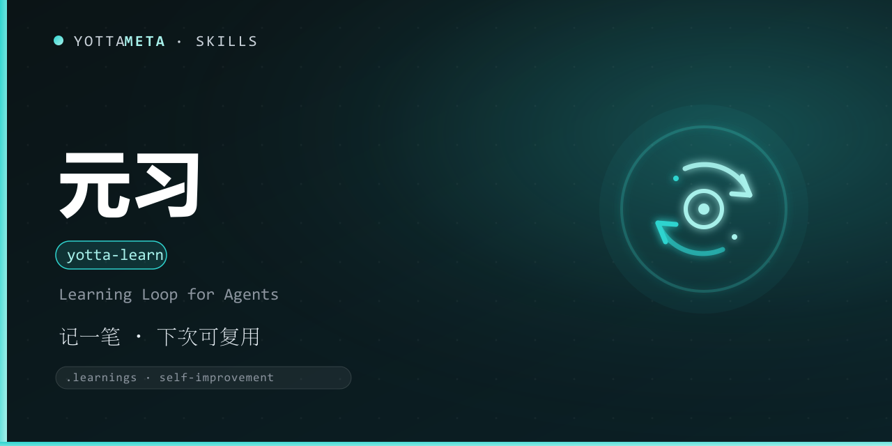

<p align="center"><b>Language</b>: English · <a href="./README.zh-CN.md">中文</a></p>

<p align="center">
  
</p>

<h1 align="center">yotta-learn · 元习</h1>

<p align="center">YottaMeta's cross-agent <b>knowledge-base</b> skill: turns reusable experience, methods, pitfalls and tutorials into a categorized <b>knowledge base</b> (draft → review → searchable) that later sessions and other agents can reuse; first-run activation is guided by the AI (KB location confirmed by the user) with automatic MCP setup.</p>
<p align="center">Activates when knowledge should be captured (command failure / user correction / a better approach / stale knowledge / a missing capability / an external-interface failure) or queried (before starting work / before solving a non-obvious problem / when the user asks "how did we solve this before"), or when the user says 知识库 / kb / 查知识 / 记一笔 / 沉淀 / 经验 / 踩坑 / self-improvement / learnings — <b>no keyword luck: writes follow the placement decision tree, queries have default timings</b>.</p>
<p align="center">Python 3.8+ standard library, zero dependencies; Windows + Linux; init never overwrites existing data.</p>

<p align="center">
  <a href="LICENSE"></a>
  <a href="https://agentskills.io/"></a>
  <a href="https://www.npmjs.com/package/@yottameta/yotta-learn"></a>
  <a href="https://github.com/YottaMeta/yotta-learn"></a>
  <a href="https://github.com/YottaMeta/yotta-learn/commits/main"></a>
  <a href="https://github.com/YottaMeta/yotta-learn"></a>
</p>

## What it is

The most common waste for an AI agent is repeating the same mistake across sessions. Yuanxi turns "what I learned this time" into "reusable next time": cross-project experience, methods, pitfalls and tutorials go into a categorized knowledge base (draft → three-question review → searchable); project-specific experience goes into the project's own files; private info goes into yotta-memory's private area.

It is not tied to one platform — it is an agent-agnostic CLI toolkit: install it into any agent that supports Agent Skills. On first use the AI guides activation (you confirm the KB location) and sets up MCP automatically — all agents on the same machine share one knowledge base.

## Core value

- **Placement decision tree** — no more hesitation about where to write: private/sensitive → yotta-memory private area; project-specific → the project's own files; cross-project reusable knowledge → this KB (draft → three-question review); facts / red lines → yotta-memory FACT; mature practices → turn into skill guardrails. In one line: "facts go to memory, methods go to the knowledge base".
- **Knowledge base** — the kb command group stores knowledge by category: category registry, draft/review, sharded index, keyword search; writes default to draft, review promotes to verified, queries return verified by default.
- **Write / query timings** — event-driven writes (failures / corrections / better approaches / stale knowledge / missing capability) plus periodic reviews; queries default to: at task start, before non-obvious problem-solving, before writing (dedup), and during reviews.
- **First-run activation** — the AI checks status → you confirm the KB location (default `~/.yottalearn/knowledge`) → the AI initializes it, writes a machine-level "discovery anchor", connects MCP, and self-checks.
- **Category governance** — reuse first (check existing categories before writing), naming rules (slug / name / description), one primary category per entry, periodic merge / deprecate.
- **Legacy compatibility** — all old `.learnings/` commands remain (read / resolve / migrate existing entries); new knowledge is no longer written there by default.
- **Optional integration** — legacy entries can `log --remember` to sync into yotta-memory; degrades gracefully and never blocks.

## Advantages

| Advantage | Description |
|---|---|
| **Shared across agents** | The KB is machine-level (`~/.yottalearn`); every agent on the same machine reads and writes the same copy. Project-specific experience still lives in the project and travels with the repo |
| **Three-question review** | Verified? self-contained? no secrets? — review requires evidence; sensitive / duplicate content is blocked (explicit `--force --note` leaves an audit trail) |
| **Categories + Chinese search** | Category registry + Chinese bigram / single-char fallback keyword search; draft / verified / deprecated state machine |
| **Usable from first install** | AI-guided activation + automatic MCP setup + machine-level discovery anchor — no shelfware |
| **Reliability built in** | Atomic writes + cross-process lock + 7-day trash + snapshots + independent-directory backup + `kb doctor` checks |
| **Zero dependency** | Python 3.8+ standard library; no daemon / no database; Windows + Linux |
| **Ecosystem distribution** | GitHub + npm dual-source; four install methods (npx / git clone / Download ZIP / install.sh) |

## Commands

| Command | Purpose |
|---|---|
| kb | Knowledge-base command group: init / config / category / add / list / review / query / index / stats / doctor / backup / trash / snapshot |
| view | Local-only web console (real runtime command; 127.0.0.1:8791) |
| log / list / review / update / resolve / promote / extract / init | Legacy `.learnings/` command group (read / resolve / migrate existing data; new knowledge is no longer written there) |
| log --remember | Legacy-entry sync to yotta-memory (optional; degrades when not installed) |

## Data protocol

- Knowledge base: defaults to `~/.yottalearn/knowledge` (config `~/.yottalearn/config.json`; any location via `kb config set --dir <path>`, `--move` migrates the old library); entries are Markdown with controlled frontmatter, IDs `KB-YYYYMMDD-XXX`, status draft / verified / deprecated; review requires evidence, queries return verified by default (`--include-draft` includes drafts).
- AI interface: MCP stdio (`scripts/yotta_learn_mcp.py`; 15 tools, write tools fail-closed and share the CLI kernel); local-only web console `yotta-learn view` (a real runtime command; 127.0.0.1 only, eight views incl. an Advanced/CLI page; equivalent to `python3 scripts/yotta_learn.py view` when run from the skill directory).
- Legacy `.learnings/` (kept for existing data): project root `.learnings/` (override with `--dir`); files LEARNINGS.md (LRN-) / ERRORS.md (ERR-) / FEATURE_REQUESTS.md (FEAT-); fields Logged / Priority / Status / Area / Pattern-Key; init is idempotent and never overwrites.
- Migration: `kb add --from-learning <LRN-ID>` turns a legacy `.learnings` entry into a KB draft (portable source reference, still gated by review).

## Usage

> Command entries: examples below use the skill-directory form `python3 scripts/yotta_learn.py`; with the CLI installed, replace that prefix with `yotta-learn` (e.g. `yotta-learn kb query 中文检索`) — both are equivalent.

```bash
# Activation & status: check first (uninitialized KB prints guidance)
python3 scripts/yotta_learn.py kb config get

# Initialize the knowledge base (default ~/.yottalearn/knowledge; for a custom location run kb config set --dir <path> first)
python3 scripts/yotta_learn.py kb init

# Dedup check -> categories -> draft -> review -> query
python3 scripts/yotta_learn.py kb query 中文检索
python3 scripts/yotta_learn.py kb category list
python3 scripts/yotta_learn.py kb category create agent-skills \
  --name "Agent & skill development" --description "Knowledge and methods for skill development and orchestration"
python3 scripts/yotta_learn.py kb add --category agent-skills \
  --title "SQLite FTS5 Chinese search pitfalls" \
  --message "Default tokenizer is weak for Chinese; use bigrams or an external tokenizer." \
  --tags "sqlite,search" --source "experiment"
python3 scripts/yotta_learn.py kb review KB-20261005-001 --pass --evidence "verified locally"
python3 scripts/yotta_learn.py kb query 中文检索

# Local-only web console
python3 scripts/yotta_learn.py view
```

**Exit-code semantics**: 0 = success; 1 = not found / nothing to do; 4 = usage or validation error; 5 = gate blocked (sensitive / duplicate); 6 = integrity (refused overwrite / corrupted data / lock timeout).
**Legacy `.learnings` category values**: `correction` / `insight` / `knowledge_gap` / `best_practice` / `error` / `other`; use `other` when unsure.

## Installation

Pick any of the four methods below; the order is the recommended priority. Skill files always come from **npm** (GitHub can be slow without a proxy; npm supports mirrors).

### Method 1: npm one-liner (recommended)

```text
# Optional China mirror: npm config set registry https://registry.npmmirror.com
npx -y @yottameta/yotta-learn install --agent <agent-name>      # install to the agent's default user-level skills dir
npx -y @yottameta/yotta-learn install --dir <your-skills-dir>   # point to the skills dir itself (e.g. ~/.codex/skills)
# Legacy form (equivalent): npx -y @yottameta/yotta-learn --agent <agent-name>
```

- `install --agent <name>` installs to that agent's default user-level directory; `install --list` shows each agent's default directory.
- `--dir <path>` installs to the given directory; for agents not in the preset list, point `--dir` at their skills directory.
- If the mirror has not synced the new package (404): add `--registry=https://registry.npmjs.org/` (a proxy may be needed in China), or wait for the mirror cache.

### Method 2: git clone (developers / git available)

```text
git clone https://github.com/YottaMeta/yotta-learn.git <your-skills-dir>/yotta-learn
```

### Method 3: GitHub Download ZIP (manual / no git)

On the GitHub repository `YottaMeta/yotta-learn`, click **Code → Download ZIP**, unzip it and put the `yotta-learn` folder into the agent's skills directory.

### Method 4: install.sh (multi-agent one-liner script)

```text
bash install.sh --agent <name>   # install to the agent's default user-level directory
bash install.sh --dir <path>     # install to the given directory
bash install.sh --list           # list agents -> default directories
```

> Method 1 uses the npm registry (npmmirror / npmjs) and does not depend on GitHub; Methods 2/3 use GitHub and may fail without a proxy in China.

## Upgrade / uninstall

- **Upgrade**: reinstall the latest version to overwrite — rerun the install command you used (e.g. `npx -y @yottameta/yotta-learn install --agent <name>` or `bash install.sh --agent <name>`). Old files in the skill directory are replaced; other project files are untouched.
- **Uninstall**: delete the `yotta-learn` folder in the target agent's skills directory. The skill stops taking effect.

## FAQ

- **Where should new knowledge go?** Follow the placement decision tree: private → yotta-memory private area; project-specific → the project's own files; cross-project reusable → this KB (draft → three-question review); facts / red lines → yotta-memory FACT; mature practices → skill guardrails.
- **Will it overwrite existing data?** No. Both `kb init` and the legacy `init` are idempotent and never overwrite existing data; old-format entries remain readable.
- **What if nobody uses it after install?** On first load the AI proactively guides activation (checks status → you confirm the KB location → init + discovery anchor + MCP setup + self-check); afterwards each session follows the default write / query timings.
- **Does it record sensitive info?** No. Private / sensitive info never enters the shared knowledge surface (use yotta-memory's private area); KB writes run a sensitive scanner and review blocks hits.
- **What about my old `.learnings/` data?** All commands remain (read / resolve / migrate); cross-project entries can be converted with `kb add --from-learning <LRN-ID>` into KB drafts, project-specific entries go into the project's own files.

## Related skills

Same YottaMeta skill matrix: [yotta-memory](https://github.com/YottaMeta/yotta-memory) (元忆, cross-session long-term memory) complements 元习 — memory holds "facts" (facts / conclusions / boundaries / private area), 元习 holds "methods" (cross-project reusable methods / processes / pitfalls); [anti-shallow](https://github.com/YottaMeta/anti-shallow) and [workflow-standard](https://github.com/YottaMeta/workflow-standard) reinforce it from the execution-discipline side.

## Development & validation

Run in this repo: `python tools/validate-skill.py yotta-learn`.

## License

MIT © YottaMeta — see [LICENSE](./LICENSE). Brand statement in [NOTICE](./NOTICE). Upstream attribution: protocol & design reference the open-source self-improving-agent family; implementation is YottaMeta's own.
